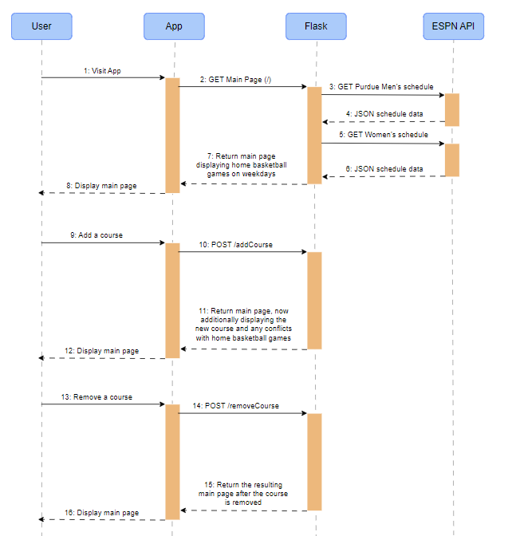

# Purdue Game Day Parking

The Purdue Game Day Parking app shows users the dates of Purdue home basketball games and any conflicts with their courses that will require alternative parking.

## The Problem

As a commuter at Purdue University, I park in the Ross-Ade Stadium parking lot, as the other lots are generally full. However, on days with home basketball games, I cannot park there at certain times, or my car will be towed. To be proactive, I want to analyze which days home basketball games may conflict with my courses, so I can plan ahead for alternative parking.

## How It Works

1. When users visit the app, it fetches the Purdue Men's and Women's college basketball schedules and displays all weekday home games to the user.
2. Users can input their class times from their course schedule, which are saved in the browser's session.
3. The app will display which basketball games conflict with their course schedule, allowing them to proactively make alternative parking plans.



## Tech Stack

- **Language:** Python
- **Libraries:** Flask / requests / datetime / zoneinfo
- **Data Storage:** Flask sessions
- **External tools:** ESPN public API (site.api.espn.com/apis/site/v2)

## Setup

```bash
git clone https://github.com/V0rsity/game-day-parking
cd game-day-parking
pip install -r requirements.txt
```

## Usage

```bash
python app.py
```

## Roadmap

- [ ] Exclude games on class breaks
- [ ] Frontend + Mobile design
- [ ] Web hosting
- [ ] View exam conflicts
- [ ] Include Friday football games
- [ ] Select courses from Purdue course catalogue (api.purdue.io)

## Author

Luke Lehman, https://github.com/V0rsity.
